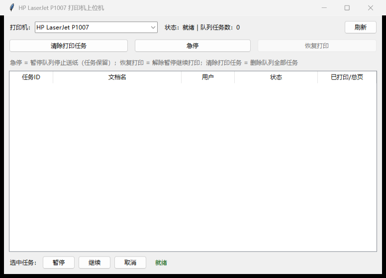

# HP LaserJet P1007 打印机上位机

一个轻量的 Windows 打印队列控制工具：**清除打印任务 / 急停 / 恢复打印**，为 HP LaserJet P1007（及 P1005/P1006/P1008/P1505 等 P1000-P1500 系列）设计，但对所有 Windows 打印机通用。



纯 Python 标准库（tkinter + ctypes 调用系统 winspool.drv），无任何第三方依赖。

## 功能

| 按钮 | 行为 | 系统调用 |
|---|---|---|
| **清除打印任务** | 删除队列中全部任务（含卡住的任务） | `SetPrinter(PURGE)`，失败自动回退逐个 `SetJob(CANCEL)` |
| **急停** | 暂停整个队列、立即停止送纸；任务保留在队列里不丢 | `SetPrinter(PAUSE)` |
| **恢复打印** | 解除暂停，从暂停处继续打印 | `SetPrinter(RESUME)` |

附加：

- 打印机下拉选择（自动优先选中 P1007），实时状态显示（就绪/已暂停/缺纸/卡纸/碳粉等）
- 队列任务列表每 2 秒自动刷新（任务 ID / 文档名 / 用户 / 状态 / 已打印页数）
- 选中单个任务可 暂停 / 继续 / 取消
- 启动时自动请求管理员权限（队列控制需要）；拒绝 UAC 则降级为只能操作自己提交的任务

## 安装步骤

### 1. 安装打印机驱动（P1007 为主机渲染打印机，必须先装驱动）

驱动是 HP 专有软件、不在本仓库分发。运行我们提供的脚本从 **HP 官方服务器**下载并校验（SHA256 + HP 数字签名双重校验）：

```powershell
.\scripts\get-driver.ps1            # 仅下载到 downloads\
.\scripts\get-driver.ps1 -Install   # 下载 + 解包 + pnputil 静默安装（弹 UAC）
```

或手动下载：[HP 官网 P1007 驱动页](https://support.hp.com/us-en/drivers/hp-laserjet-p1007-printer/3435678)，选择 Windows 64 位，下载 `ljP1000_P1500-HB-pnp-win64-en.exe` 后按向导安装。

### 2. 运行上位机

```
python app.py            # Python 3.10+，Windows
python app.py --no-elevate   # 测试时不弹 UAC
```

### 3.（可选）创建桌面快捷方式

```powershell
.\scripts\make-shortcut.ps1
```

## 实测

开发时在 Windows 11 23H2 + 真实 HP LaserJet P1007（USB）上完成全链路自测（`selftest.py`，需管理员）：

```
PASS 枚举打印机 / 查询状态
PASS 急停 → 队列进入"已暂停"态
PASS 恢复打印 → 队列回到"就绪"
PASS 造一个打印任务 → 任务入队可见
PASS 清除打印任务 → 队列清空
```

## 许可与商标

- 本仓库代码以 [MIT](LICENSE) 许可发布。
- **HP 驱动与打印机固件不在本仓库、也不允许由本仓库再分发**——它们是 HP 的专有软件，脚本只从 HP 官方服务器获取。详见 [NOTICE.md](NOTICE.md)。
- HP、Hewlett-Packard、LaserJet 是 HP Inc. 的商标；本项目与 HP Inc. 无任何隶属或背书关系。
